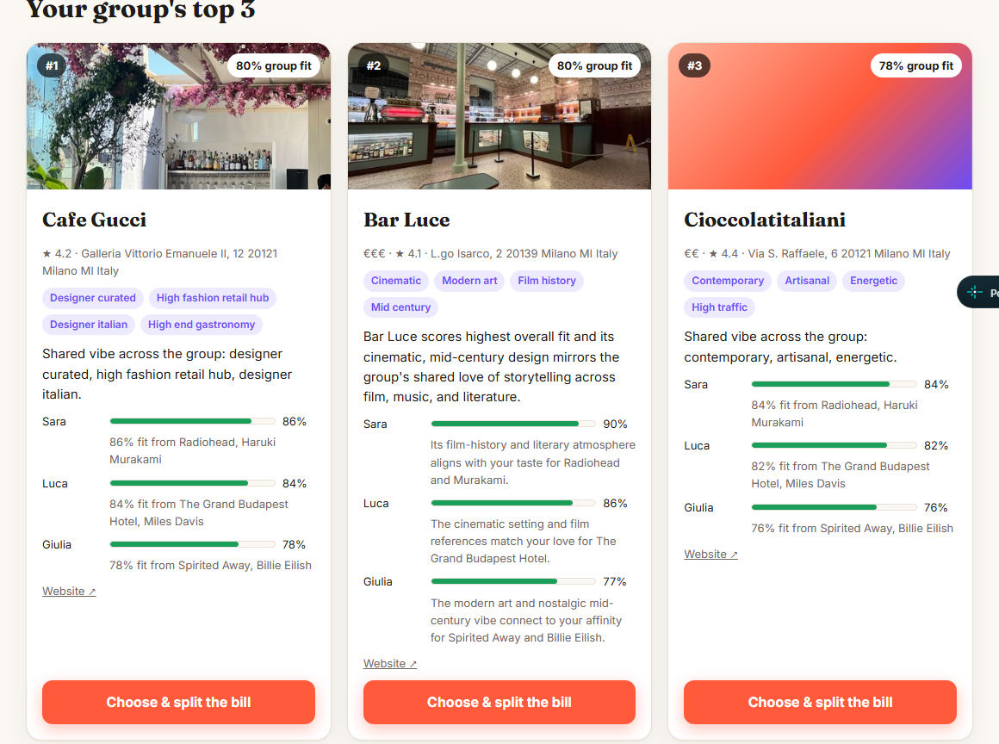

# TastePay

**Plans your whole group will love — found with Qloo's taste graph, split and paid in one place.**

Live demo: **https://tastepay.netlify.app** (no key or login needed)



## The problem

Organising a team dinner, drinks or a weekend away means guessing what everyone likes. Chat assistants answer with popular, generic picks because they know nothing about the people, and often name places that are in another city, over budget or simply invented. Then someone still has to chase everyone for money.

## What TastePay does

1. You add the people (2–8) and two or three things each of them loves: a band, a film, a book, a show. Optionally you just describe the plan in one sentence.
2. The agent resolves every favourite to a Qloo entity, asks Qloo how each person's taste maps onto venues in your city, and ranks the candidates **for the whole group**: the least-happy person first, then the average, within your budget.
3. Each pick shows a per-person fit, the taste tags the group shares (for example *Cinematic · Modern art · Film history* for a Wes Anderson-designed bar), and a short explanation.
4. Next to it, the same brief answered by an LLM **without** Qloo — and every place it named is looked up in Qloo's place graph: found in the city, in a different city, not found, or over budget.
5. Pick one and everybody pays their share with PayPal (sandbox).

## How it uses Qloo

| Step | Qloo endpoint | What we do with it |
|---|---|---|
| Resolve tastes | `GET /search` over artist, movie, TV show, book, author, person, podcast, video game, brand | First match per favourite; the alternatives are shown so the user can fix a wrong guess (Haruki vs. Takashi Murakami) |
| Per-person affinity | `GET /v2/insights` with `filter.type=urn:entity:place`, `filter.location.query`, `filter.tags` (restaurant / bar / museum / art gallery) and `signal.interests.entities` = that person's tastes | One ranked list of up to 50 venues per person |
| Group signal | same call with everyone's entities | Widens the candidate pool |
| Fair ranking | — | Every candidate gets a score for every person (a missing one is estimated just below that person's lowest known affinity); group fit = 0.6 × min + 0.4 × mean; filters on `price_level`, closed venues and locality names |
| Shared vibe | entity tags from insights | Tags carried by at least two people's own top picks, weighted by rarity in the pool |
| Venue card | entity properties from insights | Photo, today's hours, live music, specialties, what people mention (keywords), highlights, atmosphere, food and service descriptions, website, menu, phone |
| Small towns | `filter.location=POINT(lon lat)` + `filter.location.radius` | When `filter.location.query` cannot resolve a town, it is geocoded once with OpenStreetMap Nominatim and searched within 12 km |
| Fact-check | `GET /search` with `types=urn:entity:place` | Verifies the places a taste-blind LLM suggested |
| Weekend trip | `GET /v2/insights` with `filter.type=urn:entity:destination` | Destinations that fit the group |

## Architecture

```
public/            static web app (vanilla JS, no build step)
netlify/functions/ one function per agent step, each answers in < 10 s
  understand.mts   brief → structured plan (LLM, rules fallback)
  resolve.mts      favourites → Qloo entities
  rank.mts         per-person insights + fair group ranking
  explain.mts      grounded explanations (LLM, Qloo-tag fallback)
  baseline.mts     same brief without Qloo + fact-check against Qloo
  pay.mts          PayPal sandbox order create / capture
src/               qloo.ts · group.ts · agent.ts · factcheck.ts · llm.ts · paypal.ts
tests/             unit tests with synthetic fixtures (no Qloo data committed)
```

- **Keys** live only in Netlify environment variables, never in the repo or the browser.
- **Privacy**: names never leave the browser; Qloo receives only the favourites, the city and the filters. Affinities are aggregate patterns, not facts about a person.
- **LLM**: OpenRouter, a short chain of models with a time budget. Every LLM step has a deterministic fallback, so the Qloo-based plan always works even when no model answers.
- **Rate limits**: Qloo calls run at most two at a time with retry and back-off; answers are cached per function instance.
- **Photos**: Qloo's photo first; if it does not load within 5 s, the venue website's own preview image (og:image, public hosts only); otherwise a placeholder that links to the place on Google Maps (a link, no data is copied from Google).

## Run it locally

```bash
npm install
cp .env.example .env          # add QLOO_API_KEY, OPENROUTER_API_KEY, PAYPAL_CLIENT_ID, PAYPAL_CLIENT_SECRET
npx netlify dev --port 8888   # http://localhost:8888
npm test                      # unit tests
node --env-file=.env --import tsx scripts/smoke.ts   # live run of every agent step
```

`OPENROUTER_MODELS` (comma-separated) overrides the model chain.

## Testing the payment

Payments use PayPal's **sandbox**: no real money moves. In the PayPal window, log in with a sandbox buyer account, or choose "Debit or Credit Card" and use a test card from PayPal's sandbox card generator.

## Credits

- Taste data: [Qloo Taste AI™](https://www.qloo.com) (hackathon API).
- LLMs via [OpenRouter](https://openrouter.ai); payments via [PayPal](https://developer.paypal.com) sandbox; hosting on [Netlify](https://www.netlify.com).
- Built during the Qloo Agentic Hackathon (October 2026) with an AI coding assistant.

## License

MIT — see [LICENSE](LICENSE).
